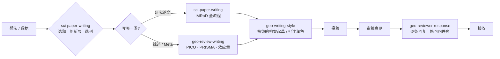

<div align="center">

# ✍️ 地理 / 遥感 SCI 论文写作 · 四件套

**写作 · 综述 · 审稿回复 · 风格档案**

从"这个想法值不值得写"到"审稿人这条意见怎么回",一条完整的链路。

面向 🌍 地理学 · 🛰️ 遥感科学与技术 · 🪨 土壤学 · 🌱 生态学 的 Agent Skill 套组。

[]()
[]()
[]()
[]()
[]()

</div>

---

## ✨ 它解决什么痛点

地理 / 遥感的 SCI 论文,难点很少真的在"英语不好"。真正的卡点通常是:

1. **创新点说不清** —— 只做了精度提升,讲不出第二层的故事,编辑初筛就挂。
2. **结构不像本行** —— 引言不从全球尺度收口、研究区写成地理课本、结果只是图表的文字翻译。
3. **综述写成文献罗列** —— 没有 PICO、没有 PRISMA,Meta 分析不报异质性和发表偏倚。
4. **审稿意见不会回** —— 逐条回复漏项、页码行号对不上、该反驳的不敢反驳、做不到的补充实验只会说做不到。
5. **一写就像 AI** —— "随着……的快速发展"开篇、满篇 *novel / robust*、防御性地满篇 *may*。

v1 只覆盖第 2、5 条。**v2 把整条链补全成四件套**:写作、综述、审稿回复、个人风格。

---

## 🆕 v2 变了什么

| | v1.0.0 | **v2.0.0** |
|---|---|---|
| skill 数量 | 1 个 | **4 个** |
| 主 skill 参考文件 | 11 个（3339 行） | **19 个（4418 行）** |
| 覆盖范围 | 论文各章节写作 | 写作 + 综述/Meta + 审稿回复 + 风格档案 |
| 目录规范 | `skills/skill.md` | `skills/<skill-name>/SKILL.md`（对齐 Agent Skills 标准） |
| 分发方式 | 一个整包 zip | 每个 skill 独立 zip + 四件套合集 zip |

主 skill 新增与改写的章节:**选刊与期刊定位**、**科学问题与创新层次**、**精度验证、不确定性与可解释性**、**图件与制图**、**批判性写作与去 AI 味**、**三类研究论文的写法**、**AI 协同写作与学术诚信**,以及课程完整讲义。

---

## 🧰 四件套一览

| Skill | 管什么 | 什么时候自动触发 | 规模 |
|---|---|---|---|
| **`sci-paper-writing`** | 英文研究论文全流程:选题、选刊、标题、摘要、Highlights、引言、研究区、数据与方法、精度验证、结果、讨论、结论、图件、去 AI 味、cover letter、投稿自查。覆盖三类论文:**时空变化**、**定量反演与模拟**、**观测对照** | 写 / 改 / 润色 / 审查论文的任何部分;问"创新点够不够""投哪本刊""讨论怎么写""SHAP 怎么写""怎么去 AI 味" | 19 个参考文件 |
| **`geo-review-writing`** | 综述类论文:一般性综述、系统综述（PRISMA 2020 / PRISMA-EcoEvo）、Meta 分析（效应量、随机效应与多水平模型、异质性、敏感性、发表偏倚）、文献计量综述（CiteSpace / VOSviewer / Bibliometrix） | 写综述、系统综述、Meta 分析、荟萃分析、文献计量、知识图谱、PRISMA、检索式、效应量 | 1 个参考文件 |
| **`geo-reviewer-response`** | 审稿意见拆解与回复信:编号分类、依赖与冲突梳理、四类情形写法（同意 / 礼貌反驳 / 无法满足 / 误读）、页码行号、修回 cover letter 与修回四件套 | 审稿意见、返修、major/minor revision、response letter、rebuttal、reject and resubmit | 2 个参考文件 |
| **`geo-writing-style`** | 从你自己满意的论文里归纳个人写作风格档案,之后按档案起草、以**批注方式**润色 | 建立写作风格、style guide、"让 AI 写得像我"、上传自己的论文要总结写作习惯 | 1 个参考文件 |

> 四个 skill 之间有软引用:`geo-review-writing` 与 `geo-writing-style` 会借用 `sci-paper-writing` 的语言规则文件（如 `13-critical-writing-de-ai.md`、`12-grammar-style.md`)。**建议四个一起装**;单独装某一个也能用,只是少了这层联动。

---

## 🔄 它们怎么协同



---

## 📦 仓库结构

```
sci-writing-geors/
├── README.md
├── INSTALL.md                        # 各平台安装说明（Claude / Codex / Kimi / DSH / WorkBuddy…）
├── CHANGELOG.md
├── VERSION
├── skills/
│   ├── sci-paper-writing/            # 研究论文写作（主 skill）
│   │   ├── SKILL.md
│   │   └── references/               # 19 个文件
│   │       ├── 00-journal-targeting.md
│   │       ├── 01-research-question.md
│   │       ├── 02-introduction.md
│   │       ├── 03-methods.md
│   │       ├── 04-validation-uncertainty.md
│   │       ├── 05-results.md
│   │       ├── 06-discussion.md
│   │       ├── 07-conclusion.md
│   │       ├── 08-abstract-highlights.md
│   │       ├── 09-title.md
│   │       ├── 10-figures.md
│   │       ├── 11-vocabulary.md
│   │       ├── 12-grammar-style.md
│   │       ├── 13-critical-writing-de-ai.md
│   │       ├── 14-cover-letter-submission.md
│   │       ├── 15-checklist.md
│   │       ├── 16-paper-types.md
│   │       ├── 17-ai-collaboration.md
│   │       └── course-handout.md
│   ├── geo-review-writing/           # 综述与 Meta 分析
│   │   ├── SKILL.md
│   │   └── references/review-methods.md
│   ├── geo-reviewer-response/        # 审稿意见回复
│   │   ├── SKILL.md
│   │   └── references/
│   │       ├── handout-response.md
│   │       └── templates.md
│   └── geo-writing-style/            # 个人写作风格档案
│       ├── SKILL.md
│       └── references/style-profile-template.md
└── dist/                             # 可直接上传的打包文件
    ├── sci-paper-writing.zip
    ├── geo-review-writing.zip
    ├── geo-reviewer-response.zip
    ├── geo-writing-style.zip
    └── geo-writing-suite-v2.0.0.zip
```

合计 **5177 行**规则与示例（含 4 份 `SKILL.md` 与 23 份参考文件）。

> `skills/` 下的全部内容直接取自《202610版地理学论文写作-审稿-回复skill》技能包，与源包逐字节一致；v1 的文件已整体移除，两版没有合并。

---

## 🚀 安装与使用

四个技能都遵循 [Agent Skills](https://agentskills.io) 标准(`<技能名>/SKILL.md`),支持该标准的工具都能直接读,装好后无需手动开启。

### 万能安装提示词

把它整段发给任意 AI 工具——Claude、ChatGPT、Codex、Kimi、WorkBuddy、DSH 都行,它会读仓库或你上传的 zip 自己装:

```text
请帮我在当前工具里安装一个现成的 Agent Skill（技能包）。

【来源】下面两样，你给我哪个就用哪个：
· 我上传的 zip 附件
· GitHub 仓库：https://github.com/Xiangyu-Ge/sci-writing-geors

【要求】
1. 先读内容，确认每个技能目录下有 SKILL.md，且 YAML 头部含 name 和 description。
2. 用你平台自带的「创建技能 / 上传技能」功能，把下面四个技能分别建成独立技能，
   不要合并成一个：
   · sci-paper-writing（研究论文写作）
   · geo-review-writing（综述与 Meta 分析）
   · geo-reviewer-response（审稿意见回复）
   · geo-writing-style（个人写作风格档案）
3. name 和 description 保持原样，一个字都别改 —— description 决定这个技能会不会被
   自动触发，改写之后就失效了。
4. references/ 下的文件作为技能的支持资料一并带上；平台只收单个文件时，就以
   SKILL.md 为主说明，其余算附件。
5. 如果你的平台根本没有「技能」功能，就退一步：把 sci-paper-writing 的 SKILL.md
   全文设成我的自定义指令 / 系统提示。
6. 装完告诉我：四个技能的名字、装在哪里、怎么触发。哪一步做不到就直接说，
   不要报告成功。
```

> 已经在用 Claude Code / Codex / Kimi Code / DSH 的,也可以手动放:
> `cp -r skills/* ~/.claude/skills/`(Codex 用 `~/.agents/skills/`,Kimi 用 `~/.config/agents/skills/`,DSH 用 `~/.dsh/skills/`)。

### 验证

```text
你现在有哪些技能？分别什么时候用？
```

报得齐 `sci-paper-writing`、`geo-review-writing`、`geo-reviewer-response`、`geo-writing-style` 四个名字才算真装上。

### 装不上怎么办

| 现象 | 原因 |
|---|---|
| 报不出四个技能名 | 只是把文字读了一遍,没真正建成技能 |
| 报得出名字但回答很泛 | 降级成提示词了,能用但不会自动触发 |
| ChatGPT 找不到 Skills 入口 | 需要 Business / Enterprise / Healthcare / Edu 等套餐 |
| Kimi 网页版没有"上传技能包" | 它不收 zip,只能用 `/skill-creator` 或文档转技能 |
| 升级后行为没变 | v1 的 `skill.md` 与 v2 的 `SKILL.md` 冲突,先删旧目录再装 |

前置条件和完整排查见 [INSTALL.md](INSTALL.md)。

---

## 💡 快速上手

### 1 · 写论文 —— `sci-paper-writing`

开场先交代四件事,让它走对分支:

```
我在写一篇土壤盐分遥感反演的论文,目标投 Catena。
数据是 Sentinel-1/2 + 120 个野外 EC 采样点。
主线是从反演结果看 2000–2024 年的盐渍化时空变化。
帮我写引言。
```

按模块推进,卡哪说哪:

- `帮我写研究区` → 走 位置 → 自然 → 土壤植被 → 意义 的漏斗
- `方法这段怎么组织` → 技术路线图在最前,再按 定义 → 原理 → 步骤 → 参数 → 本研究设置
- `精度怎么报` → `04-validation-uncertainty.md`
- `讨论里想做气候 vs 人类活动归因` → 讲清尺度效应,防止把相关写成因果
- `帮我去掉 AI 味` → `13-critical-writing-de-ai.md`
- `帮我写 cover letter,投 Catena` → `14-cover-letter-submission.md`
- `投稿前帮我过一遍` → `15-checklist.md`

### 2 · 写综述 / Meta —— `geo-review-writing`

```
我要写一篇"盐渍化遥感监测"的系统综述,目标投 Geoderma。
研究区不限,时间 2000 年至今。先帮我把问题拆成 PICO。
```

```
我想做土壤盐分反演的 Meta 分析,合并不同模型的 R²。
帮我定效应量、模型结构,并告诉我该报哪些异质性和发表偏倚指标。
```

### 3 · 回复审稿意见 —— `geo-reviewer-response`

```
这是 R1 和 R2 的意见（粘贴原文）。帮我编号拆任务、标出两人冲突的地方,
再给一张修改计划表。
```

```
审稿人说"应该用空间交叉验证",但我们用的是分层随机抽样。
帮我判断该不该反驳,怎么写。
```

### 4 · 建立个人风格档案 —— `geo-writing-style`

```
这是我的三篇一作论文（附件）。帮我归纳我的写作风格,按六类输出一份风格档案,
每条规则配 1–2 个我自己的原句作证据。
```

之后润色时默认**只批注、不改写**,由你自己决定删改。

---

## 📚 模块速查 · `sci-paper-writing`

| 你想做的事 | 读哪个文件 |
|---|---|
| 选刊、编辑初筛、反向工程目标期刊 | `00-journal-targeting.md` |
| 创新点够不够、科学问题、故事怎么讲 | `01-research-question.md` |
| 引言 | `02-introduction.md` |
| 研究区、数据、方法 | `03-methods.md` |
| 精度验证、交叉验证、不确定性、SHAP | `04-validation-uncertainty.md` |
| 结果 | `05-results.md` |
| 讨论 | `06-discussion.md` |
| 结论 | `07-conclusion.md` |
| 摘要、Highlights、Graphical Abstract | `08-abstract-highlights.md` |
| 标题 | `09-title.md` |
| 图件、配色、地图 | `10-figures.md` |
| "这里怎么说"、词汇与句式 | `11-vocabulary.md` |
| 时态、语态、衔接、确定性、标点、中式英文 | `12-grammar-style.md` |
| 防御性写作、去 AI 味 | `13-critical-writing-de-ai.md` |
| Cover letter、投稿材料、桌面拒稿 | `14-cover-letter-submission.md` |
| 投稿前自查 | `15-checklist.md` |
| 三类论文的结构差异与自查 | `16-paper-types.md` |
| AI 协同写作、学术诚信、润色规则 | `17-ai-collaboration.md` |
| 课程完整讲义（案例、模板、选题公式） | `course-handout.md` |

---

## 🎯 服务的三类论文

| | **【时空变化】** | **【定量反演与模拟】** | **【观测对照】** |
|---|---|---|---|
| 典型问题 | 某地表过程在一段时间内怎么变、为什么变 | 用遥感 + 辅助数据估算某地表 / 土壤属性 | 处理与对照相比有什么差别 |
| 例子 | 盐渍化扩张、植被退化 / 绿化、城市热岛演变 | 土壤盐分 / SOC / 土壤水分 / LST 反演 | 野外施肥、灌溉、覆盖试验 |
| 重心 | 变化检测 + 趋势 + **格局与驱动归因** | 建模 + 变量选择 + **精度验证** | 试验设计 + **对照可比性 + 效应量** |
| 常投 | RSE / IJRS / JAG / Catena / Geoderma | RSE / ISPRS J / TGRS / IJRS / JAG | Catena / Geoderma / Agriculture, Ecosystems & Environment |

> 也支持组合论文——"先反演、再用反演结果做时空分析",以其中一条为主线展开即可,不要两条并列。

---

## 🔬 核心方法:反向工程

最底层的信念不是"教语法",而是**反向工程**——先解构成功论文的结构与语言模式,再套用到自己身上。冲顶刊时务必做这一步:

1. 准备 **4 篇以上目标论文**（同期刊、近 3–5 年、对象与手段相近）。
2. 给每节**数段数句**,给每句**写一个功能描述**（"在做什么",不是"在说什么"）。
3. 提取高频动词、连接词、句式;记录研究区怎么开头、传感器参数怎么列、精度报哪几个指标、变化速率怎么表述。
4. 2–3 篇之后,目标期刊的"隐性规范"就到手了。**规范怎么变,这套方法不过时。**

---

## 🛡️ 边界与诚信

- **不编造**数据、参数、精度、文献和机理。缺什么就标 `[需补充：…]`,宁可留空。
- **不越界**替你做判断:创新层归作者,数据归作者,结论强度归作者。技能负责组织叙事、规范表达、提示该写什么。
- **默认批注、不擅自改写**:除非你明确说"直接改",否则只标问题。
- **会变的信息**(期刊政策、分区、影响因子)一律提醒以官网最新为准。

---

## 📄 版本与更新

| 版本 | 日期 | 内容 |
|---|---|---|
| **v2.0.0** | 2026-11-03 | 重构为 4 个 skill;主 skill 参考文件 11 → 19;新增综述、审稿回复、风格档案三件 |
| v1.0.0 | 2026-06-03 | 单 skill,11 个参考文件（[归档下载](https://github.com/Xiangyu-Ge/sci-writing-geors/releases/tag/v1.0.0)） |

详细变更见 [`CHANGELOG.md`](CHANGELOG.md)。

---

## ❓ 常见问题

**Q:免费版能用吗?**
预置技能任何人都能用;但**上传自定义技能**需要 Pro / Max / Team / Enterprise 且开启代码执行。

**Q:为什么我在 Claude Code 里看不到网页上传的技能?**
自定义技能按用户、按平台单独存储,不跨 claude.ai / API / Claude Code 同步,每个平台各自配置。

**Q:只装其中一个行不行?**
行。但 `geo-review-writing` 和 `geo-writing-style` 会引用 `sci-paper-writing` 的语言规则文件,四个一起装效果最完整。

**Q:它会替我编造数据或文献吗?**
不会,也不应该。四个 skill 都把"不编造"写进了硬约束,缺信息一律标注待补。

**Q:适用别的地学方向吗（水文、地貌、生态遥感）?**
通用骨架完全适用;领域示例以土壤 / 盐渍化 / 植被为主,把对象换掉即可沿用同一套结构。

**Q:怎么定制?**
`geo-writing-style` 就是为定制而生:先用它建一份你自己的档案,后续所有起草和润色都按你的习惯来。

---

## 🙏 致谢与来源

- 写作骨架来自课程《科技论文写作》讲义（`course-handout.md`）、期刊编辑与方法学文献的公开经验,以及作者本人的写作经验。
- 各参考文件末尾列出所依据的来源。
- 这不是范文代写工具,而是**写作脚手架**;请配合阅读目标期刊近作使用。

---

## 📚 引用

如果这个技能包对你的研究或教学有帮助,欢迎按下面方式引用:

```bibtex
@misc{ge2026sciwritinggeors,
  title  = {sci-writing-geors: 地理/遥感 SCI 论文写作四件套},
  author = {Ge, Xiangyu},
  year   = {2026},
  note   = {Version 2.0.0},
  url    = {https://github.com/Xiangyu-Ge/sci-writing-geors}
}
```

---

## 📜 许可

本仓库内容用于教学与科研写作辅助。转载或再分发请注明来源仓库与作者。技能格式遵循 [Agent Skills 开放标准](https://agentskills.io),可在支持该标准的平台间复用。

---

<div align="center">

*如果它帮到了你,欢迎 Star ⭐ 并把使用心得反馈回来。*

</div>
